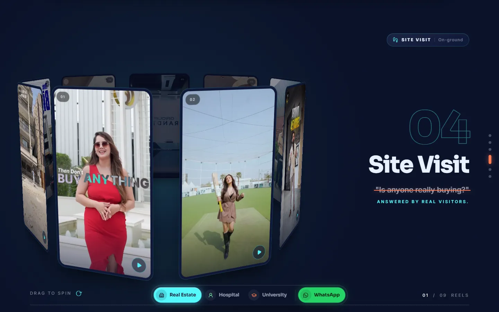
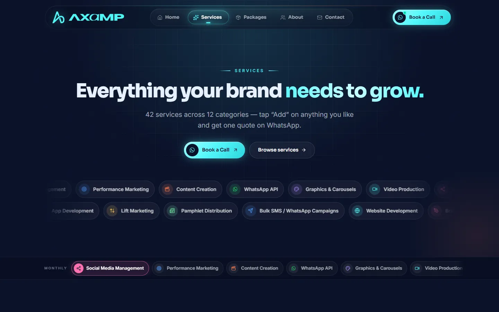
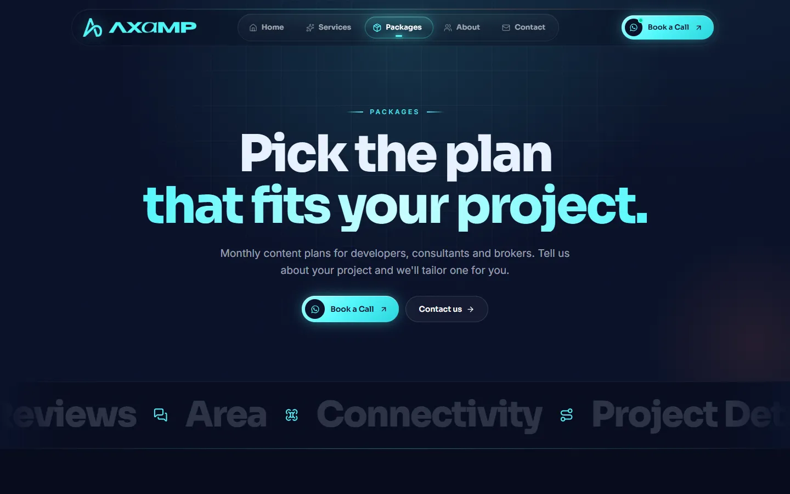
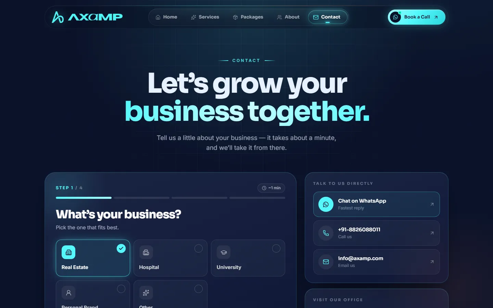
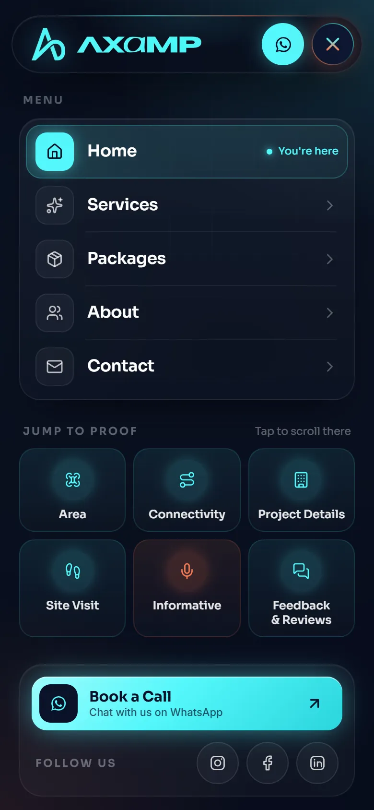

<div align="center">

<a href="https://www.axamp.com">
  
</a>

<h1>AXAMP — We build proof.</h1>

<p>
  <strong>The official website of AXAMP Private Limited</strong><br />
  Viral video marketing for real estate developers, consultants and brokers — and for hospitals, universities and personal brands.
</p>

<p>
  <a href="https://www.axamp.com"></a>
</p>

<p>
  
  
  
  
  
</p>

<p>
  <a href="https://www.axamp.com"><b>Visit the site</b></a> ·
  <a href="#getting-started"><b>Run it locally</b></a> ·
  <a href="#environment-variables"><b>Configure .env</b></a> ·
  <a href="#deployment"><b>Deploy</b></a>
</p>

</div>

---

## Table of contents

- [Overview](#overview)
- [Screenshots](#screenshots)
- [Features](#features)
- [Tech stack](#tech-stack)
- [Getting started](#getting-started)
- [Environment variables](#environment-variables)
- [Available scripts](#available-scripts)
- [Project structure](#project-structure)
- [Managing content](#managing-content)
- [Adding videos](#adding-videos)
- [Deployment](#deployment)
- [Troubleshooting](#troubleshooting)
- [Contact](#contact)

---

## Overview

Most agency websites make claims. **AXAMP's website shows proof.**

Every buyer has doubts before a site visit — *Is there demand here? How far is it, really? Is it actually being built?* The site answers each doubt with a real video: drone shots, walkthroughs, on-ground visits and expert explainers. Visitors scroll through **six kinds of proof**, see real campaign numbers, and book a call on WhatsApp in one tap.

The home page adapts to the visitor's industry — **Real Estate**, **Hospital** or **University** — and swaps every headline, proof section and video to match.

🌐 **Live:** [www.axamp.com](https://www.axamp.com)

---

## Screenshots

<table>
  <tr>
    <td width="50%">
      
      <p align="center"><b>Six kinds of proof</b><br /><sub>Each buyer doubt answered by a spinning 3D ring of real videos</sub></p>
    </td>
    <td width="50%">
      
      <p align="center"><b>Services</b><br /><sub>42 services in 12 categories, with a WhatsApp quote builder</sub></p>
    </td>
  </tr>
  <tr>
    <td width="50%">
      
      <p align="center"><b>Packages</b><br /><sub>Monthly content plans for developers, consultants and brokers</sub></p>
    </td>
    <td width="50%">
      
      <p align="center"><b>About</b><br /><sub>The story, the founder and the team</sub></p>
    </td>
  </tr>
  <tr>
    <td colspan="2">
      
      <p align="center"><b>Contact</b><br /><sub>A four-step form that emails every lead to the team, plus direct WhatsApp, phone and email</sub></p>
    </td>
  </tr>
</table>

### Mobile

<p align="center">
  
  &nbsp;&nbsp;&nbsp;
  
</p>
<p align="center"><sub>Fully responsive — the mobile menu gives one-tap access to every page and every proof section.</sub></p>

---

## Features

**Experience**
- **Industry switcher** — Real Estate, Hospital and University, each with its own copy, proof sections and videos
- **Six kinds of proof** — pinned, scroll-driven sections with draggable 3D video rings
- **Performance section** — real client reels with views and likes, Meta and Google Ads results, and Google Business Profile reviews
- **Lead engine** — an animated walkthrough of how a viewer becomes a booked site visit
- **Smooth scrolling and motion** — GSAP ScrollTrigger animations with Lenis smooth scroll

**Conversion**
- **Book a Call** on WhatsApp from every page, with a pre-filled message
- **Four-step contact form** that emails each lead to the team through Resend
- **Services quote builder** — add services, then send one quote request on WhatsApp

**Engineering**
- **Self-hosted video** with poster images, lazy loading and an Instagram embed fallback
- **Content kept in data files** — videos, services, prices and team live in `src/data/`, not in components
- **Two mail back ends** — a Node serverless function (Vercel and local dev) and a PHP mailer (Hostinger), both driven by the same `.env`
- **Secrets stay on the server** — API keys are never bundled into the browser code

---

## Tech stack

| Area | Technology |
| --- | --- |
| Framework | [React 19](https://react.dev) |
| Build tool | [Vite 8](https://vite.dev) |
| Styling | [Tailwind CSS 4](https://tailwindcss.com) with CSS custom properties for the design tokens |
| Animation | [GSAP](https://gsap.com) + ScrollTrigger, [Lenis](https://lenis.darkroom.engineering) smooth scroll |
| Routing | [React Router 7](https://reactrouter.com) |
| Carousels | [Swiper](https://swiperjs.com) |
| Icons | [Lucide](https://lucide.dev) and custom SVG icons |
| Email | [Resend](https://resend.com) |
| Hosting | Hostinger (Apache + PHP); also ready for Vercel |

---

## Getting started

### Prerequisites

- **Node.js** `20.19+` or `22.12+` — [download](https://nodejs.org)
- **npm** (comes with Node.js)
- A **Resend** account if you want the contact form to send emails — [sign up](https://resend.com) (free tier is enough)

### Installation

```bash
# 1. Clone the repository
git clone https://github.com/RahulXTech/Axamp.git
cd Axamp

# 2. Install dependencies
npm install

# 3. Create your environment file
cp .env.example .env
#    then open .env and fill in your values (see the next section)

# 4. Start the development server
npm run dev
```

Open the address Vite prints — usually **http://localhost:5173**.

> The whole site works without a `.env` file. Only the contact form needs it to send emails.

---

## Environment variables

All settings live in a file called **`.env`** in the project root. It holds private values such as your API key, so it is **listed in `.gitignore` and never committed**. The repository ships a safe template, **`.env.example`**, with every setting and no real values.

### What to put in `.env`

```dotenv
# ─── Contact form (Resend) ───────────────────────────────────────────

# REQUIRED — your Resend API key. Starts with "re_".
RESEND_API_KEY=re_xxxxxxxxxxxxxxxxxxxxxxxxxxxx

# OPTIONAL — who receives the leads. Separate several addresses with commas.
# Default: info@axamp.com
CONTACT_TO_EMAIL=info@axamp.com,sales@axamp.com

# OPTIONAL — who the email appears to come from.
# The domain must be verified in Resend (see below).
# Default: AXAMP Website <onboarding@resend.dev>
CONTACT_FROM_EMAIL=AXAMP Website <leads@axamp.com>
```

| Variable | Required | Default | Description |
| --- | :---: | --- | --- |
| `RESEND_API_KEY` | **Yes** | — | The API key that lets the site send email through Resend. Without it the contact form shows an error and no lead is sent. |
| `CONTACT_TO_EMAIL` | No | `info@axamp.com` | The inbox (or inboxes) that receive each lead. Use commas for more than one: `a@axamp.com,b@axamp.com`. |
| `CONTACT_FROM_EMAIL` | No | `AXAMP Website <onboarding@resend.dev>` | The sender name and address shown in the lead email. Use the format `Name <address>`. |

### How to get each value

**1. `RESEND_API_KEY`**
1. Sign in at [resend.com](https://resend.com).
2. Go to **API Keys → Create API Key**.
3. Give it a name (for example `axamp-website`), choose **Sending access**, and create it.
4. Copy the key — it starts with `re_` and is shown **only once** — and paste it into `.env`.

**2. `CONTACT_FROM_EMAIL` — verify your domain first**

Until a domain is verified, Resend only allows the test sender `onboarding@resend.dev`, and it can **only deliver to the email address that owns the Resend account**. To send from your own address and reach any inbox:

1. In Resend, go to **Domains → Add Domain** and enter `axamp.com`.
2. Add the DNS records Resend shows (SPF, DKIM and, optionally, DMARC) in your domain's DNS settings at Hostinger.
3. Wait for the domain to show **Verified**, then set, for example, `CONTACT_FROM_EMAIL=AXAMP Website <leads@axamp.com>`.

**3. `CONTACT_TO_EMAIL`** — any inbox your team checks. No setup needed.

**4. Google Sheet (optional) — `GOOGLE_SHEETS_WEB_APP_URL`, `GOOGLE_SHEETS_SECRET`**

Each lead from the lead loss report's **"Find the reason"** form is also added to the Google Sheet's **`Leads`** tab as one row: the time, name, email, mobile, then a column for every report answer and number (the "how it's worked out" note sits under its value in the same cell), then the report link and source. Row 1 gets the column headings automatically when the tab is blank. The lead still counts as received if only one of the email or the sheet gets it.

The website's server posts each lead to a small **Google Apps Script web app** on the sheet ([`docs/google-apps-script.gs`](docs/google-apps-script.gs)). No Google Cloud project or service account key is needed. The secret is checked by the script and lives only on the server, never in the browser.

1. Make up a long random secret (for example 40+ letters and numbers).
2. Open the Google Sheet → **Extensions → Apps Script**. Replace everything in `Code.gs` with the contents of `docs/google-apps-script.gs` and click **Save**.
3. In Apps Script, open **Project Settings (⚙) → Script Properties → Add script property**: name `AXAMP_SECRET`, value your secret. **Save**.
4. Click **Deploy → New deployment → ⚙ Select type → Web app**. Set **Execute as: Me** and **Who has access: Anyone**, then **Deploy** and allow access when Google asks. Copy the **Web app URL** (it ends in `/exec`).
5. In `.env`, set `GOOGLE_SHEETS_WEB_APP_URL` to that URL and `GOOGLE_SHEETS_SECRET` to the same secret as `AXAMP_SECRET`.
6. Check it: opening the `/exec` URL in a browser shows `{"ok":true,"service":"AXAMP leads"}`.
7. Rebuild (`npm run build`) and upload `dist/` again for Hostinger.

If you edit the script later, publish the change with **Deploy → Manage deployments → ✏ Edit → Version: New version → Deploy**. The URL stays the same.

### Where these values are used

| Environment | How the values are read |
| --- | --- |
| **Local development** (`npm run dev`) | Vite loads `.env` and runs `api/contact.js` for `POST /api/contact`. |
| **Hostinger** | `npm run build` writes the values into `dist/api/config.php`, which `public/api/contact.php` reads. `.htaccess` blocks anyone from opening that file in a browser. |
| **Vercel** | Add the same variables under **Project → Settings → Environment Variables**. `api/contact.js` runs as a serverless function. |

### Security notes

- **Never commit `.env`** or `dist/api/config.php`. Both are already in `.gitignore`.
- None of these variables start with `VITE_`, so **Vite never puts them into the browser bundle** — they stay on the server.
- `dist/` contains your API key after a build. Upload it only to your own hosting and don't share it.
- If a key is ever exposed, **delete it in Resend straight away** and create a new one.

---

## Available scripts

| Command | What it does |
| --- | --- |
| `npm run dev` | Starts the development server with hot reload and the local contact form API |
| `npm run build` | Builds the production site into `dist/` (including `dist/api/config.php` for Hostinger) |
| `npm run preview` | Serves the production build locally so you can check it before deploying |

---

## Project structure

```text
Axamp/
├── api/
│   └── contact.js            # Contact form mailer — Vercel and local dev
├── docs/
│   └── screenshots/          # Images used in this README
├── public/
│   ├── .htaccess             # Hostinger: page routing and security rules
│   ├── api/contact.php       # Contact form mailer — Hostinger (PHP)
│   ├── assets/               # Team photos, logos and partner images
│   ├── posters/              # Cover images shown before each video plays
│   ├── services/             # Service card images
│   └── videos/               # Self-hosted videos (see videos/README.txt)
├── src/
│   ├── pages/                # One file per page: Home, Services, Packages, About, Contact
│   ├── components/           # Page sections: Nav, Hero, Pillar, Performance, ContactForm …
│   ├── data/                 # All site content: videos, services, prices, team, links
│   ├── lib/                  # Shared logic: smooth scroll, navigation, animation helpers
│   ├── App.jsx               # Routes and page wrapper
│   ├── main.jsx              # Entry point
│   └── styles.css            # Design tokens (colours, fonts) and global styles
├── .env.example              # Template for your .env file
├── index.html
├── package.json
└── vite.config.js            # Vite, Tailwind, local API and the Hostinger config step
```

---

## Managing content

Content is kept apart from the code. **Most updates only need a change to one file in `src/data/`:**

| To change… | Edit |
| --- | --- |
| Real estate proof videos and captions | `src/data/work.js` |
| Hospital proof videos | `src/data/hospital.js` |
| University proof videos | `src/data/university.js` |
| Client reels and their numbers (Performance section) | `src/data/reels.js`, `src/data/performance.js` |
| Services and categories | `src/data/services.js` |
| Package prices | `src/data/pricing.js` |
| Team, founder and About page text | `src/data/about.js` |
| Phone, email, WhatsApp and social links | `src/data/site.js` |
| Partner logos | `src/data/partners.js` |

---

## Adding videos

1. Put the video in **`public/videos/<name>.mp4`**.
2. Put a cover image in **`public/posters/<name>.webp`** (540 × 960 is ideal).
3. Add it to the right data file, for example in `src/data/work.js`:

   ```js
   { file: '<name>', caption: 'Short description of the video' }
   ```

**Recommended format:** H.264 MP4, 720 × 1280, around 2–4 Mbps, with *faststart* so it starts playing before it has fully downloaded. Smaller files start faster, especially on mobile data. With [ffmpeg](https://ffmpeg.org):

```bash
ffmpeg -i input.mp4 -vf scale=720:-2 -c:v libx264 -crf 24 -preset slow \
  -c:a aac -b:a 128k -movflags +faststart public/videos/<name>.mp4
```

`public/videos/README.txt` lists every video and where it is used.

---

## Deployment

### Hostinger (production — www.axamp.com)

1. Make sure `.env` is filled in on the machine you build from.
2. Build the site:
   ```bash
   npm run build
   ```
3. Upload **everything inside `dist/`** to `public_html` (File Manager or FTP), replacing the old files.
4. Open [www.axamp.com](https://www.axamp.com), send a test message from the contact form, and check that it arrives.

`dist/` includes `.htaccess`, which sends every page address (such as `/about`) to the app and routes `/api/contact` to the PHP mailer.

### Vercel (alternative)

1. Import the GitHub repository into [Vercel](https://vercel.com).
2. Framework preset: **Vite**. Build command: `npm run build`. Output directory: `dist`.
3. Add the [environment variables](#environment-variables) in **Project → Settings → Environment Variables**.
4. Deploy. `api/contact.js` runs as a serverless function automatically.

---

## Troubleshooting

<details>
<summary><b>The contact form says it could not send</b></summary>

- Check that `RESEND_API_KEY` is set in `.env` (locally) or in your hosting settings, then rebuild and upload again for Hostinger.
- If you are still using `onboarding@resend.dev`, Resend only delivers to the account owner's email. Verify your domain and set `CONTACT_FROM_EMAIL`.
- Look at the **Logs** page in Resend for the exact reason.

</details>

<details>
<summary><b>Videos are slow to start</b></summary>

Large video files take longer to start, especially on mobile data. Compress them with the ffmpeg command in [Adding videos](#adding-videos) — this usually cuts the size by about two-thirds with no visible loss in quality.

</details>

<details>
<summary><b>A page shows "404" when refreshed on Hostinger</b></summary>

The `.htaccess` file is missing from `public_html`. It starts with a dot, so some FTP tools hide it — make sure hidden files are shown and uploaded.

</details>

<details>
<summary><b><code>npm install</code> or <code>npm run dev</code> fails</b></summary>

Check your Node.js version with `node -v`. You need `20.19+` or `22.12+`.

</details>

---

## Contact

**AXAMP Private Limited**

🌐 [www.axamp.com](https://www.axamp.com) &nbsp;·&nbsp; ✉️ [info@axamp.com](mailto:info@axamp.com) &nbsp;·&nbsp; 📞 [+91-8826088011](tel:+918826088011)

---

<div align="center">
<sub>© AXAMP Private Limited. All rights reserved.</sub>
</div>
